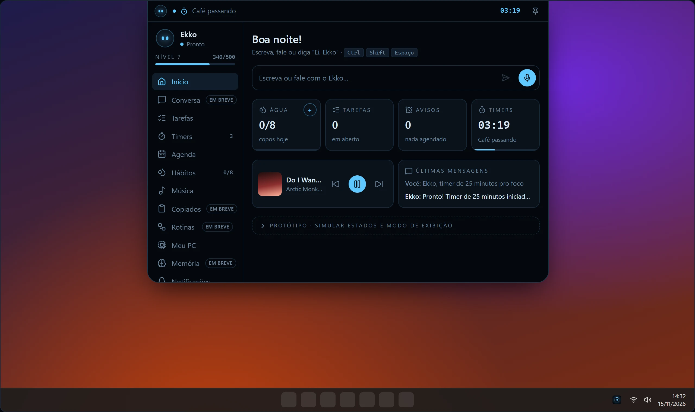
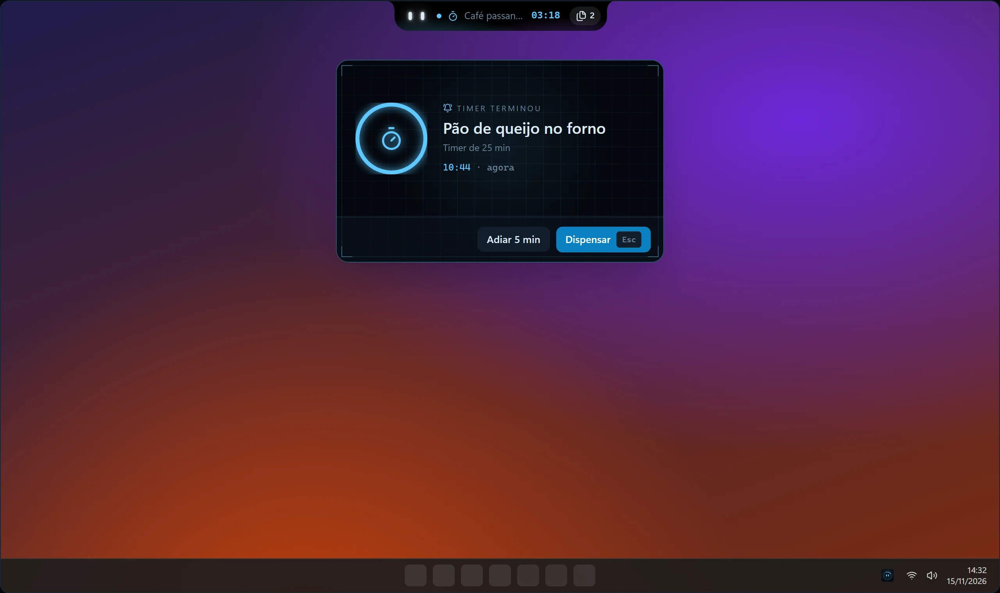
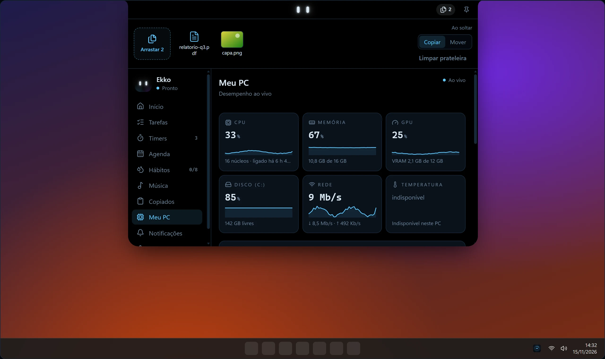
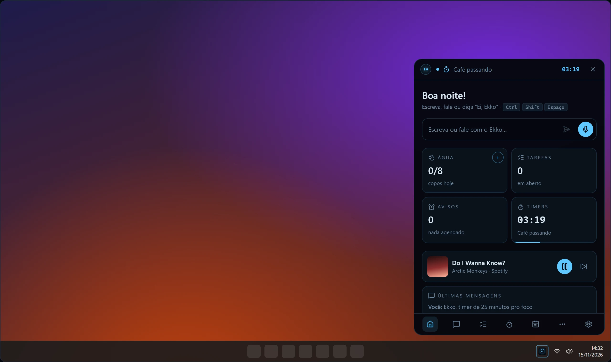
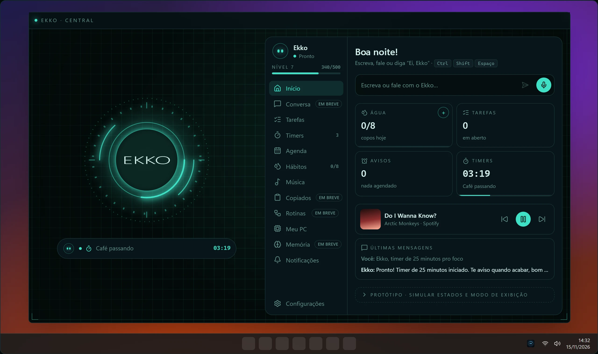
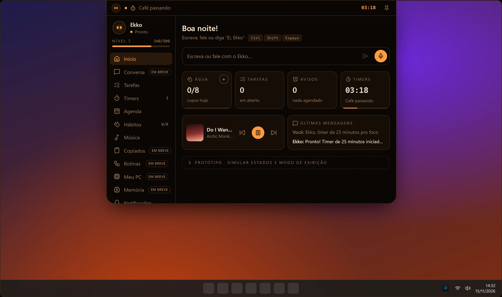
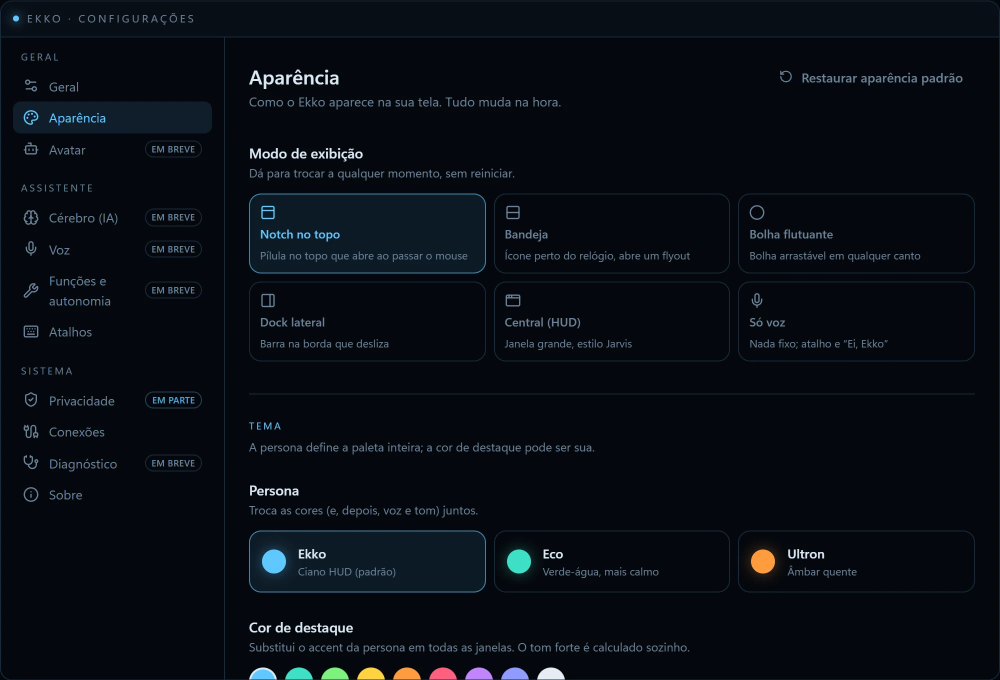
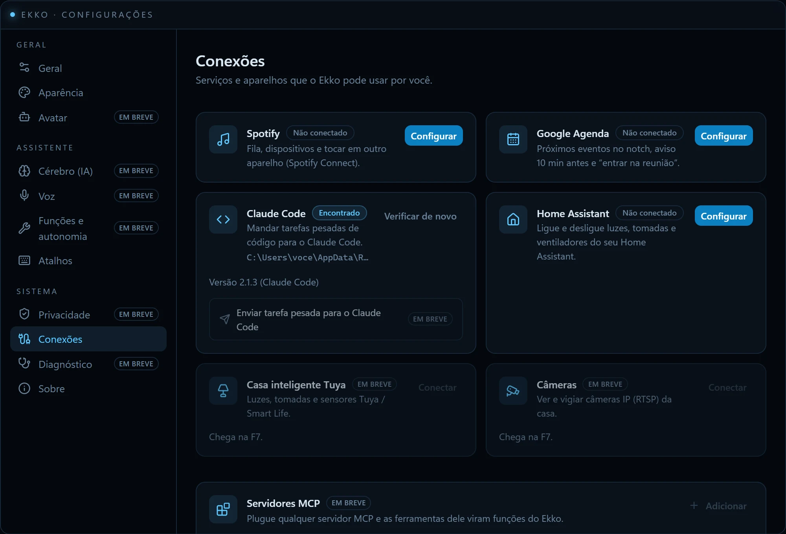
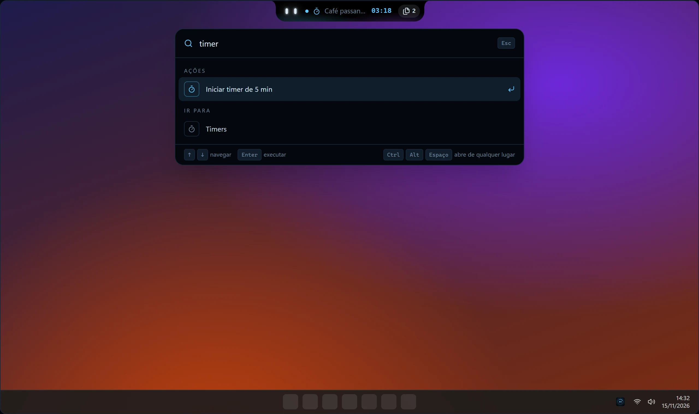
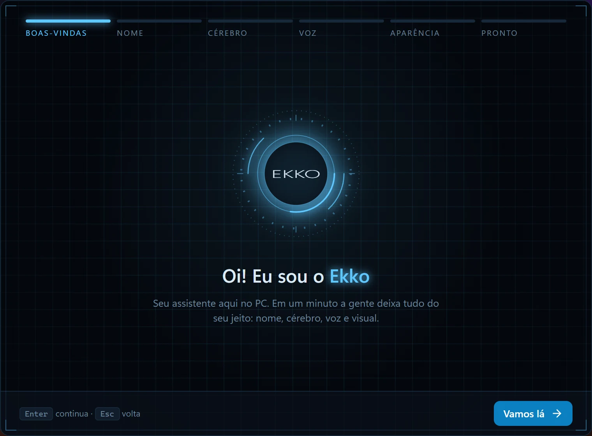

# Ekko

**Um assistente que mora no topo da sua tela.** O Ekko ("eco") fica num notch discreto no alto do Windows e mostra o que importa agora: o timer correndo, a música tocando, a próxima reunião. Ao passar o mouse, ele abre um painel com tudo que você precisa no dia.



> **Versão 0.3.0, prévia.** O que já funciona está listado abaixo. As telas que ainda não estão prontas ficam fora dos menus até a fase delas chegar.

## Baixar

1. Baixe o instalador `Ekko_0.3.0_x64-setup.exe` em **[Releases](https://github.com/Guilhermee19/ekko-hub/releases/latest)**.
2. Rode o instalador. O app ainda não tem assinatura digital, então o Windows SmartScreen pode mostrar um aviso. Clique em **Mais informações → Executar assim mesmo**.
3. Na primeira vez, as boas-vindas pedem seu nome e o jeito que você quer ver o Ekko.

**Requisitos:** Windows 10 ou 11 (64 bits). O WebView2 já vem no Windows 11; no Windows 10, o instalador baixa se faltar.

## O que ele faz

### Sempre à vista, sem atrapalhar

A pílula no topo muda conforme o que está acontecendo. Você escolhe o que ela mostra e em que ordem.

| Timer correndo | Música tocando | Ouvindo você |
|---|---|---|
|  |  |  |

- **Timers e Pomodoro:** continuam contando com o painel fechado. Quando acabam, o Ekko mostra um alarme na tela, com a opção "Adiar 5 min".
- **Música:** mostra o que toca em qualquer player do Windows (o app do Spotify, o YouTube no navegador e outros), com tocar/pausar, próxima, anterior e o volume do Windows. As barrinhas no notch seguem o som de verdade.
- **Do seu jeito:** escolha os cards do Início (água, tarefas, agenda, Meu PC, copiados…) e arraste para mudar a ordem; escolha também quais páginas aparecem no menu.
- **Agenda:** conectado ao Google Agenda, mostra o próximo compromisso 15 minutos antes e avisa 10 minutos antes.
- **Tarefas, lembretes, água e hábitos:** ficam salvos no seu PC, e os lembretes tocam na hora certa.
- **Some quando precisa:** em jogos e vídeos em tela cheia, o Ekko se esconde sozinho.



### Uma prateleira no notch e o histórico do que você copia

- **Prateleira de arquivos:** arraste arquivos ou pastas até o notch e solte (imagens aparecem com prévia). Eles ficam guardados ali e depois saem todos juntos (ou um a um) quando você arrasta para outra pasta, o e-mail ou o chat. Você escolhe se o Ekko copia ou move.
- **Copiados:** o Ekko guarda o histórico do texto que você copia, com busca, fixar e pausar. Senhas copiadas de gerenciadores de senha ficam de fora.

### De olho no seu PC



- **Ao vivo:** CPU, memória, GPU (uso e VRAM), disco e rede, com gráfico do último minuto.
- **O que está rodando:** cada programa numa linha só (as 40 abas do Chrome viram "Chrome"), ordenada por memória ou CPU.
- **Finalizar tarefa:** o Ekko tenta fechar o programa direitinho e, se ele não responder, força. Sempre pede confirmação, e os processos essenciais do Windows ficam protegidos.
- **Verificar meu PC:** analisa memória, processador, programas que abrem com o Windows, arquivos temporários, lixeira e espaço em disco. Também limpa temporários antigos e esvazia a lixeira, avisando antes quanto espaço vai liberar.

### Do jeito que você quiser

O Ekko não precisa ficar no topo. Escolha entre **notch**, **bandeja** (perto do relógio), **bolha flutuante**, **dock lateral**, **central** (uma janela grande) ou **só voz**. A troca acontece na hora.

| Bandeja, perto do relógio | Central |
|---|---|
|  |  |

Você também escolhe a cor (qualquer uma, ou as personas Ekko, Eco e Ultron) e o formato, a transparência, o brilho e o tamanho do notch. Dá para arrastar o notch pela borda de cima e levá-lo para outro monitor.

| Persona Ultron | Configurações de aparência |
|---|---|
|  |  |

### Conectado ao que você já usa



- **Spotify:** fila, dispositivos, aleatório e repetir. Controlar a reprodução exige uma conta Premium.
- **Google Agenda:** seus próximos compromissos no notch.
- **Home Assistant:** liga e desliga luzes, tomadas e ventiladores.
- **Claude Code:** o Ekko detecta se está instalado.

Cada serviço tem um passo a passo dentro do app. O Ekko não usa uma conta própria nesses serviços: você conecta com as suas credenciais.

### Rápido no teclado

| Atalho | O que faz |
|---|---|
| `Ctrl + Shift + Espaço` | Chama o Ekko de qualquer lugar |
| `Ctrl + Alt + Espaço` | Abre a paleta de comandos (usa `Alt + Shift + Espaço` se outro programa já ocupa a primeira) |

Os dois são configuráveis em *Configurações → Atalhos*. Se outro programa já usa a combinação, o Ekko avisa.

| Paleta de comandos | Boas-vindas |
|---|---|
|  |  |

## Em breve

| O quê | Quando |
|---|---|
| Comandos de voz ("Ei, Ekko, timer de 5 minutos") | próxima versão |
| Conversa com IA (grátis, no seu PC ou com sua chave) | F2 |
| Rotinas automáticas | F5 |
| Controle do PC por voz/IA (abrir apps, janelas, organizar arquivos) | F6 |
| Memória, MCP, casa inteligente Tuya e câmeras | F7 |
| O personagem animado do Ekko | F8 |

O plano completo está no [roadmap](docs/ROADMAP.md).

## Privacidade

- **Tudo fica no seu PC.** Configurações, tarefas e hábitos são salvos em `%APPDATA%\dev.guidev.ekko\`.
- **Chaves e tokens** (Spotify, Google, Home Assistant) ficam no **Gerenciador de Credenciais do Windows**, nunca em arquivo de texto.
- **Toda ação no PC fica registrada:** finalizar tarefas e limpezas vão para um log local que você vê em *Configurações → Privacidade*.
- **O Ekko não envia telemetria.**

## Problemas?

Abra uma [issue](https://github.com/Guilhermee19/ekko-hub/issues) dizendo o que aconteceu, a sua versão do Windows e, se der, um print.

---

## Para desenvolvedores

Feito com Tauri 2, React 19, TypeScript, Tailwind 4 e um workspace Rust (`crates/`).

- **Roadmap:** [docs/ROADMAP.md](docs/ROADMAP.md).
- **Arquitetura:** [docs/ARCHITECTURE.md](docs/ARCHITECTURE.md).
- **Design:** [docs/DESIGN.md](docs/DESIGN.md).
- **Regras para quem contribui (pessoas e agentes):** [AGENTS.md](AGENTS.md).

### Rodar

Requisitos: Node 24+, Rust estável (MSVC) e WebView2.

```bash
npm install
npm run tauri dev     # o app de verdade (notch, bandeja, atalhos)
npm run dev           # galeria no navegador (http://127.0.0.1:1420), com todos os modos e dados de exemplo
```

### Checar

```bash
npm run check         # eslint + tsc + vitest
npm run rust:check    # clippy -D warnings + cargo test
```

### Testes de ponta a ponta

Os testes de ponta a ponta rodam no app real sem mexer no seu mouse ou teclado. O script conduz a janela pelo DevTools Protocol do WebView2.

```bash
# 1. Suba o app com a porta de depuração aberta
WEBVIEW2_ADDITIONAL_BROWSER_ARGUMENTS=--remote-debugging-port=9333 npm run tauri dev
# 2. Com a janela de boas-vindas aberta (primeira vez, ou Configurações → Geral → Refazer boas-vindas)
npm run e2e:onboarding
```

### Release

Quem publica é o GitHub Actions ([`.github/workflows/release.yml`](.github/workflows/release.yml)). Basta empurrar uma tag com a mesma versão do `tauri.conf.json` e ter as notas em `docs/releases/<tag>.md`:

```bash
git tag -a v0.1.0 -m "Ekko Hub v0.1.0"
git push origin v0.1.0       # o Actions compila e publica o release com o Ekko_0.1.0_x64-setup.exe anexado
```

O GitHub sempre adiciona "Source code (zip/tar.gz)" sozinho. O que as pessoas baixam é o `.exe` em *Assets*.

Para testar o instalador localmente antes de publicar:

```bash
npm run tauri build          # gera target/release/bundle/nsis/Ekko_<versão>_x64-setup.exe
npm run e2e:smoke-release    # abre o .exe de release e confere que todas as janelas montaram
```

O teste de fumaça existe porque o build de produção pode quebrar onde o modo dev não quebra. Já aconteceu: um build disparado de `c:\` minúsculo empacotava o React duas vezes e abria janelas vazias (ver `apps/desktop/vite.config.ts`).

### Prints do README

Os prints saem da galeria, com dados de exemplo, e nunca de uma área de trabalho real:

```bash
cd apps/desktop && npx vite --open false        # galeria em 127.0.0.1:1420
msedge --headless=new --remote-debugging-port=9400 --user-data-dir=<pasta temporária>
node scripts/screenshots.mjs                    # grava docs/screenshots/*.webp
```
