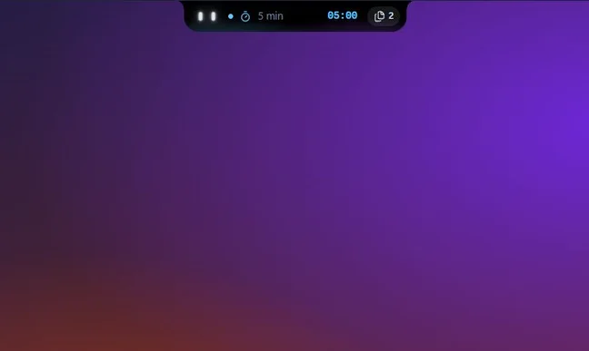
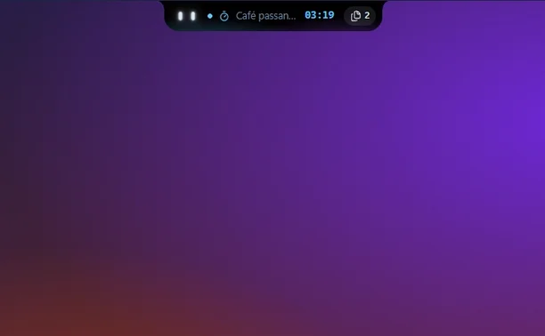
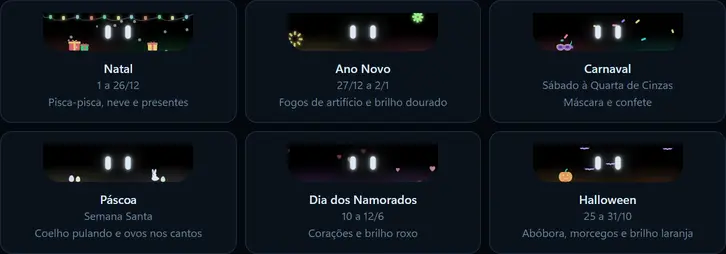
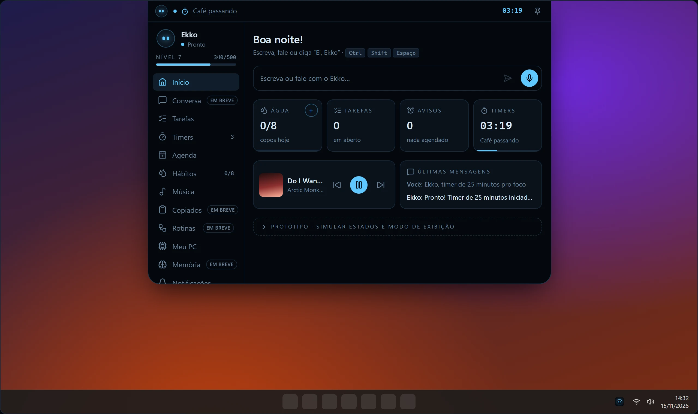
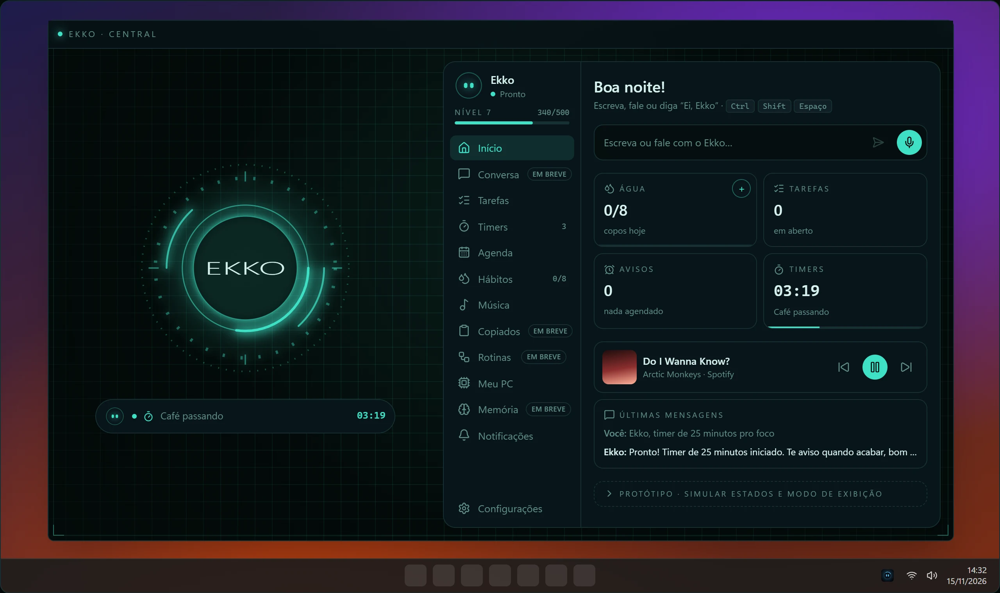
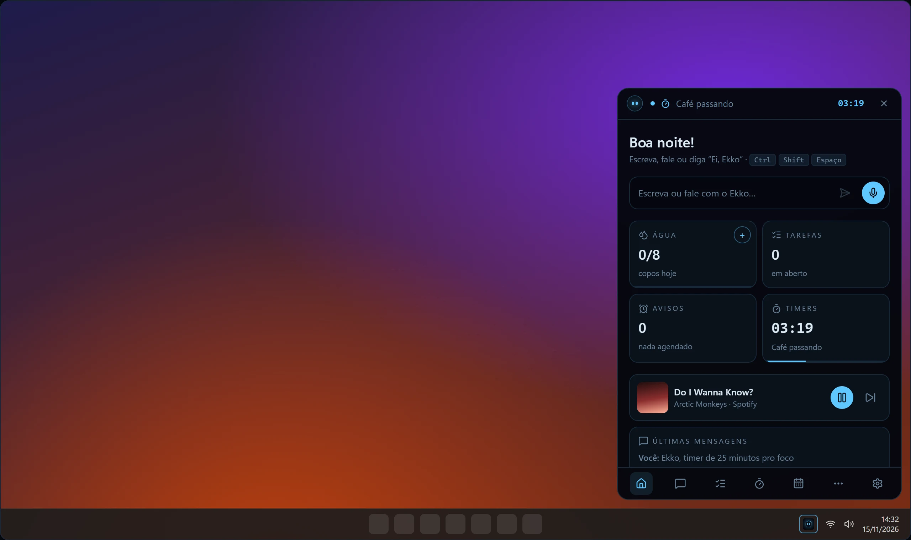

# Roadmap: Ekko Hub

> O Ekko ("eco") é um assistente de desktop **local-first para Windows** (com uma prévia para macOS). Ele mora no topo da tela, conversa por texto e voz, usa IA grátis, local ou paga, e controla o PC.
> Referências: Kobi (experiência do produto), jarvis-tauri-ia (identidade visual e base de funções) e claude-usage-tray (modo bandeja).

**Regra do roadmap:** cada fase termina com uma **aprovação do Guilherme**. A fase seguinte só começa depois disso.
**Ordem:** telas → conversa e IA → voz → funções (da mais fácil à mais complexa) → integrações → avatar → polimento → v2 (servidor + celular).

Legenda: `[ ]` a fazer · `[~]` em andamento · `[x]` feito

---

## Visão geral

| Fase | Tema | Status |
|---|---|---|
| F0 | Fundação (repo, workspace, tema, lint, testes) | `[x]` |
| F1 | UX/UI completa com dados mock (3 rodadas) | `[x]` |
| F1.5 | Prioridade do Guilherme: aparência, timers, música, agenda, Spotify, voz | `[~]` |
| F2 | Conversa + IA (grátis, local, paga) | `[ ]` |
| F3 | Voz completa (wake word, Whisper, Piper) | `[ ]` |
| F4 | Funções fáceis (tools básicas) | `[ ]` |
| F5 | Produtividade (tarefas, lembretes, hábitos, rotinas) | `[ ]` |
| F6 | Controle do PC | `[ ]` |
| F7 | Integrações (MCP, memória, casa, câmeras…) | `[~]` Spotify e Google Agenda adiantados na F1.5 |
| F8 | Avatar do Ekko | `[ ]` |
| F9 | Polimento v1 (autostart, update, diagnóstico) | `[~]` instalador v0.9.0 (Windows e prévia macOS) pela branch `production`, com atualização em um clique |
| V2 | Servidor + app no celular | `[ ]` |

## Como está hoje (v0.9.0)

Gravado da galeria com dados de exemplo (`scripts/screenshots.mjs` e `scripts/animations.mjs`).

| O notch abrindo | Os humores do Ekko |
|---|---|
|  |  |

| Avisos no notch | A paleta de comandos |
|---|---|
|  |  |

| Início no notch | Central | Bandeja |
|---|---|---|
|  |  |  |

## Releases

Um release sai quando a branch `production` recebe um merge: o GitHub Actions compila o instalador do Windows e o `.dmg` do macOS, cria a tag `v<versão>` e publica. Nas outras branches nada é compilado nem publicado (passo a passo no README, seção Release).

| Versão | Data | O que tem |
|---|---|---|
| **v0.9.0** | 27/11/2026 | **E-mail** só leitura: Gmail e Outlook (Hotmail) em Conexões, página E-mail com não lidos e todos, e aviso no notch de e-mail novo, os dois com **Ver** abrindo a mensagem no navegador. **Clima** pela Open-Meteo: cidade em Configurações → Clima, card no Início com o tempo agora e as próximas horas, e aviso no notch de chuva forte ou tempestade com 1 a 6 h de antecedência. |
| **v0.8.0** | 27/11/2026 | Modo de exibição **Barra de tarefas**: um widget dentro da barra do Windows com a música tocando (capa, nome e voltar/tocar/avançar) ou os olhos do Ekko; o clique abre o painel logo acima. O **print de área** já vai direto para a área de transferência, pronto para colar. |
| **v0.7.0** | 23/11/2026 | Página **Cores**: grade, espectro e controles RGB, opacidade, variações, salvar, fixar (as fixadas não saem do histórico, que guarda 32) e colar código em HEX, rgb ou hsl. Botões de voltar, tocar/pausar e avançar na música do notch (opcional em Pílula e avisos). **Meu PC** mostra a temperatura do sistema e da placa de vídeo, sem precisar de administrador. |
| **v0.6.2** | 23/11/2026 | Correção: o `.dmg` do macOS não saía no release da v0.6.1 (um teste da limpeza da pasta temporária falhava no Mac). |
| **v0.6.1** | 23/11/2026 | Correção: o aviso da reunião ficava fixo no notch o evento inteiro. Agora tem **Confirmar** no aviso e no notch; o Ekko avisa antes, na hora e, sem confirmação, de novo depois, com ícone de atraso no notch até confirmar. Antecedência, repetições e intervalo configuráveis em Notificações (padrão: 5 min antes, na hora e 5 min depois). Prévia para macOS: `.dmg` universal (Apple Silicon e Intel) no mesmo release. |
| **v0.6.0** | 21/11/2026 | Pegar uma cor da tela (Win+Shift+C) com lupa, HEX/RGB/HSL para copiar e card Cores com as últimas 16; avisos no próprio notch (música nova, timer e lembrete com Adiar, agenda, bateria, aparelho conectado) no lugar das janelas; paleta e painel abrem e fecham com animação; o Ekko fica sempre por cima das outras janelas e, com Esconder em tela cheia, nada aparece sobre o jogo (os alarmes esperam). Correção: o alarme do timer não abre mais por cima de um jogo em tela cheia. |
| **v0.5.0** | 21/11/2026 | Atualizar com um clique (Sobre verifica o GitHub, baixa, confere e instala); bateria do fone HyperX Cloud Stinger Core Wireless e dos mouses Attack Shark pelo dongle USB; temas de época no notch (Natal, Ano Novo, Carnaval, Páscoa, Dia dos Namorados, Halloween) com aba própria; todos os modos de exibição com o visual do notch; trocas de humor suaves; timer com qualquer tempo; persona Eco virou Tobby; o nível de mentira saiu do painel. |
| **v0.4.0** | 20/11/2026 | Agenda como calendário (o mês inteiro com os eventos em cada dia, navegação entre meses e a lista do dia escolhido) e card Agenda do Início com a folha do dia; Google Agenda pronto para conectar com um clique; olhos do Ekko em cápsula, com humor (sono, dormindo, susto, animado); Copiados guarda imagens e arquivos, com limite de 20 a 200 itens; Configurações reorganizadas em telas próprias (Notificações, Copiados, Modo de exibição, Notch, Pílula e avisos, Menu do painel). Correções: avisos rápidos que ficavam presos no notch, avisos de texto seguindo o tempo configurado e janelas cortadas com a escala da interface diferente de 100%. Primeira versão publicada pela branch `production`; as v0.3.1 e v0.3.2 não chegaram a ser publicadas e entraram nesta. |
| **v0.3.0** | 19/11/2026 | Print de uma área (Alt Gr + Print Screen) que vai para o notch; notch que reage ao sistema (volume, brilho, Caps Lock, microfone, fones) com tempo ajustável; avisos de bateria do notebook e de aparelhos Bluetooth; Início personalizável (adicionar, mover, remover, largura de 1 a 4 colunas, mesma altura) com card Bateria; menu do painel configurável; barras da música que seguem o som do PC; prévia das imagens na prateleira; Verificar meu PC com nota de saúde; contorno e velocidade de abrir do notch. Correções no arrastar para reordenar e nos avisos que ficavam presos no notch. A v0.2.0 não chegou a ser publicada e entrou nesta. |
| **v0.1.3** | 19/11/2026 | Notch novo (preto, orelhas, luz embaixo e olhos do Ekko), prateleira de arquivos no notch (soltar e arrastar todos juntos, copiar ou mover), Copiados real (histórico do clipboard com fixar, buscar e pausar). Conversa, Rotinas, Memória e as configurações sem efeito saíram dos menus até ficarem prontas. |
| **v0.1.0** | 16/11/2026 | Primeira prévia: notch e 6 modos de exibição, aparência personalizável, timers/Pomodoro, tarefas, lembretes, água e hábitos reais, música e volume do Windows, Spotify, Google Agenda, Home Assistant, iniciar com o Windows, esconder em tela cheia, não perturbe, atalhos configuráveis. O resto é protótipo marcado como **Em breve** no app. |

## O que já funciona de verdade (v0.9.0)

| Área | Status no app | Detalhe |
|---|---|---|
| Notch, barra de tarefas, bandeja, bolha, dock, central, só voz | Real | Troca sem reiniciar, arrastar e posição salva, multi-monitor, esconde em tela cheia |
| Configurações | Real | Separadas por assunto: Geral (nomes, inicialização), Notificações (som, não perturbe), Copiados, Aparência (persona, cor, escala, tom, movimento), Modo de exibição (modo, monitor, lado do dock), Notch (posição, abrir, tamanho, visual com contorno), Pílula e avisos (o que mostra, prioridade, tempo dos avisos), Menu do painel, Clima (cidade e aviso de chuva), Atalhos, Privacidade, Conexões |
| Início | Real | Cards escolhidos pelo usuário (adicionar, mover arrastando com prévia, remover, largura de 1 a 4 colunas, todos da mesma altura): Água, Tarefas, Avisos, Timers, Agenda, Meu PC, Bateria, Copiados, Prateleira, Tocando agora, Cores, Clima |
| Timers e Pomodoro | Real | Rodam no backend, aparecem no notch, alarme em tela, adiar 5 min |
| Tarefas, lembretes, água e hábitos | Real | Salvos em disco (`productivity.json`), lembretes disparam aviso + alarme, viram o dia à meia-noite |
| Notificações | Real | Avisos de timers e lembretes; som e "não perturbe" |
| Música | Real | Qualquer player do Windows, volume do Windows, arrastar a barra, barras no notch que seguem o som e botões de voltar, tocar/pausar e avançar ao lado delas (opcional em Pílula e avisos); com Spotify: fila, dispositivos, aleatório, repetir |
| Agenda (Google) | Real | Calendário do mês com os eventos em cada dia e a lista do dia escolhido, avisos configuráveis (antes, na hora e repetidos até confirmar), evento no notch até confirmar, card do Início com a folha do dia; conecta com um clique quando o instalador leva o cliente OAuth do Ekko (senão, com o seu Client ID) |
| Conexões | Real | Spotify, Google Agenda, Gmail, Outlook (Hotmail), Home Assistant (luzes/tomadas), Claude Code (detecção); MCP, Tuya e câmeras marcados F7 |
| Atalhos | Real | Chamar, paleta e print trocáveis (gravando a tecla ou com um clique em atalhos prontos), com aviso de conflito; os de voz/ditado/seleção ficam salvos e ativam quando a função chegar |
| Paleta, boas-vindas, alarme, confirmação | Real | |
| Meu PC | Real | CPU/RAM/GPU/disco/rede e temperatura ao vivo (zona térmica do sistema pelo contador do Windows e placa de vídeo pelo driver, sem admin), processos agrupados, finalizar tarefa (protegidos), verificação com nota de saúde (0 a 100), cartões por item e limpeza de temporários e lixeira, log de auditoria |
| Copiados | Real | Histórico de textos, imagens (salvas em PNG) e arquivos, copiar de volta como estava, fixar, buscar, pausar, guardar os últimos 20, 50, 100 ou 200; senhas de gerenciadores ficam de fora |
| Cores | Real | Conta-gotas na tela (Win+Shift+C) e página própria: grade, espectro (saturação × brilho com barra de matiz) e controles RGB, opacidade nos códigos copiados, variações, colar HEX/rgb/hsl, salvar e fixar; guarda 32 recentes mais as fixadas (`colors.json`) |
| E-mail | Real | Gmail e Outlook (Hotmail), só leitura: página E-mail com não lidos e todos (os 20 mais recentes de cada conta, olhados a cada minuto) e aviso no notch de e-mail novo, sem promoções e respeitando o Não perturbe; **Ver** abre a mensagem no navegador |
| Clima | Real | Cidade buscada pela Open-Meteo (grátis, sem chave), card no Início com o tempo agora, mínima/máxima e as próximas horas, e aviso no notch de chuva forte ou tempestade com antecedência configurável (1 a 6 h), um por período de chuva e respeitando o Não perturbe |
| Print de tela | Real | Alt Gr + Print Screen congela o monitor, você escolhe a área (um clique pega a tela inteira); o PNG vai para Imagens\Ekko e para o notch, onde um clique copia a imagem e arrastar leva o arquivo; fechar ou esperar 7 s tira da prateleira |
| Notch reage ao sistema | Real | Volume (inclusive pelas teclas), brilho da tela do notebook, Caps Lock, microfone mudo e fones conectados aparecem na pílula e somem sozinhos (tempo de 1 a 10 s em Pílula e avisos, que vale também para os avisos de texto); liga e desliga em Pílula e avisos |
| Olhos do Ekko | Real | Cápsulas que piscam e olham em volta; ficam com sono após 3 min sem mexer no PC e dormem após 8 min; levam susto (acordar, Caps Lock, bateria fraca, timer tocando) e ficam animados (carregador, fone conectado, arquivos na prateleira) |
| Bateria | Real | Aviso no notch quando começa a carregar e em 15%, 10% e 5% (com som); card no Início com notebook, aparelhos Bluetooth (fone, mouse, teclado, celular, controle) e periféricos com dongle USB (HyperX Cloud Stinger Core Wireless, mouses Attack Shark), cada um com seu ícone num anel de carga |
| Prateleira de arquivos | Real | Solte arquivos no notch; eles esperam ali (imagens com prévia) e saem juntos arrastando para outro lugar (copiar ou mover) |
| Conversa, Rotinas, Memória | **Escondidas** | Telas prontas, fora dos menus até a fase chegar (`src/lib/availability.ts`: status `soon` = escondido) |
| Cérebro (IA), Voz, Funções, Avatar, Diagnóstico | **Escondidas** | Seções das Configurações fora do menu até ter efeito; Privacidade fica (auditoria real) |

---

## F0: Fundação

- [x] Repo `ekko-hub` + docs (ROADMAP, ARCHITECTURE, DESIGN, AGENTS)
- [x] Workspace Cargo (`crates/*` + `apps/desktop/src-tauri`)
- [x] `ekko-core`: tipos de settings (DisplayMode, Persona), erros
- [x] App desktop: Tauri 2 + Vite + React 19 + TS + Tailwind 4 + zustand
- [x] Tokens de tema e personas (`data-persona`) portados do Jarvis
- [x] Lint e formatação: clippy (`deny`), rustfmt, ESLint, Prettier
- [x] Testes: `cargo test`, `vitest`
- [x] Modo galeria no navegador (`npm run dev`): todas as superfícies lado a lado, sem Tauri

**Pronto quando:** `npm run tauri dev` abre o Ekko com tema e troca de persona funcionando.

---

## F1: UX/UI (protótipo real com dados mock) ✅

O frontend fala com o backend só via `lib/ipc`. Na F1 tudo vem de `lib/ipc/mock`, e cada fase seguinte troca o mock pelo real **sem mexer na UI**.

### F1a: design system + Notch + modos de exibição
- [x] Componentes base: Button, IconButton, Card, Segmented, Kbd, HudFrame, EkkoCore (orb), EkkoFace (avatar provisório), Waveform, Slider, ProgressBar · F1b: StatCard, Badge, ProgressRing, PageHeader, EmptyState, Toggle, Input, Check
- [x] **Notch** com todos os estados: repouso · hover/expandido · ouvindo · pensando (cancelar) · falando (interromper) · toast · atividade viva (timer, música, volume)
- [x] **Bandeja**: ícone + flyout ancorado acima da taskbar (work area + cursor) + menu de contexto (com troca de modo)
- [x] **Orb flutuante**: bolha arrastável
- [x] **Dock lateral**: barra na borda que desliza
- [x] **Central (HUD)**: janela grande com o orb do Jarvis
- [x] **Só voz**: overlay mínimo efêmero
- [x] Troca de modo sem reiniciar + modo salvo nos settings
- [x] Hover do notch preciso (área de clique = parte visível, sem atualização fora de ordem)
- [x] **Personalização do notch**: arrastar pela barra de cima (inclusive entre monitores), posição (prévia arrastável + Esquerda/Centro/Direita), monitor, tamanho do painel (Compacto/Normal/Grande), abrir por hover ou clique, atraso do hover, repouso em pílula ou linha mínima
- [x] Notch fica aberto enquanto você digita ou depois de clicar; fecha ao clicar fora ou com Esc
- [x] **Aprovação 1a** (ajustes: hover preciso + personalização do notch)

### F1b: painel e telas
Cada tela fica em `features/<tela>/` com um store zustand próprio (dados mock) que a F2+ troca pelo backend.
- [x] Shell do painel (sidebar estilo Kobi, contadores ao vivo, menu "Mais" no compacto; o nível/XP de mentira saiu em 21/11/2026)
- [x] Início: saudação, input (manda para a Conversa), cards (água, tarefas, avisos, timers), música tocando, últimas mensagens
- [x] Conversa: bolhas, streaming simulado (parar), log de ações com confirmar/cancelar, anexar print, sugestões
- [x] Tarefas e Lembretes: listas, prioridade, subtarefas, repetição, atrasadas, concluídas
- [x] Timers e Foco: timers nomeados (aparecem no notch), cronômetro com voltas, Pomodoro
- [x] Hábitos: água, leitura, exercício, pausas, sequência de 7 dias, dica de pausa
- [x] Música: capa, controles, volume, fila, dispositivo, "Conectar Spotify"
- [x] Copiados: histórico do clipboard (fixar, buscar, limpar) + snippets
- [x] Rotinas: gatilho → ações, ligar/desligar, rodar agora, editor
- [x] Meu PC: status ao vivo com gráficos, programas pesados, verificação com anel de progresso
- [x] Memória: fatos, notas e mapa (grafo)
- [x] **Aprovação 1b**

### F1c: configurações e fluxos
- [x] Janela de Configurações: Geral, Aparência, Avatar (prévia), Cérebro (IA), Voz, Funções e Autonomia, Atalhos, Privacidade e Segurança, Conexões, Diagnóstico, Sobre
- [x] Onboarding: boas-vindas → nome → IA → voz → modo de exibição → pronto (janela própria na primeira vez; "Refazer boas-vindas" em Geral)
- [x] Paleta de comandos (janela própria; `Ctrl+Alt+Espaço`, ou `Alt+Shift+Espaço` se o primeiro estiver ocupado; também no menu da bandeja)
- [x] Diálogo de confirmação de ação arriscada (perigosa exige 3 s; "Desfazer" por 6 s)
- [x] Notificações (central no painel + toast no notch) e alarme em tela (janela própria, adiar 5 min)
- [x] Regra de permissão (autonomia × risco × exceção por função) em `toolsModel.ts`, base do loop da F4
- [x] **Aprovação 1c**

---

## F1.5: Prioridade do Guilherme (antes da IA)

Ordem pedida em 15/11/2026: aparência, voz e integrações antes da conversa com IA.

- [x] Timers de verdade no backend (rodam com o painel fechado, aparecem no notch, disparam alarme)
- [x] Música tocando no notch via Windows (GSMTC: Spotify, navegador, qualquer player) + controles
- [x] Aparência personalizável: cor livre, formato/tamanho/transparência/brilho do notch, o que aparece na pílula e prioridade
- [x] Conexões reais: Spotify (OAuth PKCE) e Google Agenda (OAuth), próximo evento no notch e aviso 10 min antes
- [x] Selos "Em breve" / "Em parte" no app em tudo que ainda é protótipo (`src/lib/availability.ts`)
- [x] Instalador Windows **v0.1.0** (NSIS) no GitHub Releases
- [x] **v0.1.3**: notch novo, prateleira de arquivos, Copiados real e protótipos escondidos dos menus
- [x] **v0.3.0**: Início e menu personalizáveis, barras da música reais, prévia de imagens, Meu PC novo, print de uma área, notch que reage ao sistema e avisos de bateria
- [x] **v0.4.0**: calendário na Agenda, humores do Ekko, Copiados com imagens e arquivos, Configurações reorganizadas e Google Agenda com um clique
- [~] Comandos de voz: interpretador pt-BR pronto e testado (`ekko-core/intents.rs`); falta microfone (reconhecimento do Windows), executar e responder com a voz do Windows
- [x] Spotify na página Música (fila, volume, dispositivos reais quando conectado) + volume do Windows
- [x] Finalizar tudo que estava "Em parte": Início, Notificações, Música, Geral, Atalhos, Conexões (+ Tarefas e Hábitos reais)
- [x] Notch com a forma da spec P1 (preto da moldura, orelhas côncavas, luz embaixo, olhos do Ekko)
- [x] Prateleira de arquivos no notch (soltar, guardar, arrastar todos ou um a um, copiar/mover)
- [x] Copiados real: histórico do clipboard do Windows salvo em `clipboard.json`
- [x] Barras da música seguem o som de verdade (captura do que o PC toca, 4 faixas: grave a agudo)
- [x] Menu do painel configurável: mostrar/esconder páginas e mudar a ordem (*Configurações → Menu do painel*)
- [x] Início personalizável: adicionar, mover e remover cards (Água, Tarefas, Avisos, Timers, Agenda, Meu PC, Copiados, Prateleira, Tocando agora)
- [x] Prateleira mostra a prévia das imagens soltas no notch
- [x] Verificar meu PC com nota de saúde, cartões por verificação e animações
- [x] Arrastar para reordenar (Início, menu, prioridade da pílula) funcionando dentro do app, com prévia ao vivo de como vai ficar
- [x] Print de uma área (Alt Gr + Print Screen): seleção na tela congelada, PNG em Imagens\Ekko, card no notch para copiar ou arrastar, que some (e sai da prateleira) ao fechar ou após 7 s
- [x] Atalho do print trocável nas Configurações, inclusive Print Screen sozinho e atalhos prontos
- [x] Notch reage ao sistema: volume pelas teclas, brilho, Caps Lock, microfone mudo e carregador
- [x] Bateria do notebook e dos fones Bluetooth na pílula, com aviso de bateria fraca
- [x] Avisos rápidos somem sempre no tempo configurado, inclusive com eco atrasado ou outra janela reagindo; avisos de texto usam o mesmo tempo (v0.4.0)
- [x] Escala da interface sem cortar Configurações, Central e painel (v0.4.0)
- [x] Agenda como calendário: mês inteiro com os eventos em cada dia, navegar entre meses, eventos do dia escolhido; card do Início com a data e os próximos eventos (v0.4.0)
- [x] Olhos do Ekko em cápsula, com humor: fica com sono (3 min sem mexer no PC) e dorme (8 min), leva susto ao acordar, com Caps Lock ligado, bateria fraca e timer tocando, e fica animado ao conectar o carregador ou um fone e ao guardar arquivos na prateleira
- [x] Copiados guarda imagens (PNG em `clipboard\`) e arquivos, além de texto, e copia de volta como estavam; limite de 20, 50, 100 ou 200 itens em Configurações → Geral, apagando as imagens que saem do histórico
- [x] Bateria de periféricos sem fio com dongle USB: HyperX Cloud Stinger Core Wireless e mouses Attack Shark no card Bateria e nos avisos de bateria fraca, sem aviso enquanto carregam ([ADR 0001](adr/0001-wireless-usb-batteries.md))
- [ ] Confirmar no app: bateria do HyperX e do Attack Shark no card Bateria e no notch
- [ ] Confirmar no app: copiar imagem (navegador, print) e arquivos (Explorador) e colar de volta pelo Copiados
- [x] Trocas de humor do Ekko suaves: cada humor chega no seu ritmo (adormecer devagar, susto rápido), o olho sai do meio de um piscar ou cochilo sem pular, o sorriso e o "z" aparecem e somem esmaecendo, e as reações tocam sem recriar os olhos (`ui/ekkoMotion.ts`); no notch aberto os olhos ficam sempre no meio, e na pílula deslizam do centro para a esquerda quando aparece um timer, música ou aviso
- [x] Timer com qualquer tempo (horas, minutos e segundos, até 99 h), além dos atalhos de 1, 5, 10, 25 e 60 min
- [x] Temas de época no notch, com aba própria nas Configurações (os olhos do Ekko não mudam; o fundo ganha enfeites e o brilho de baixo a cor da data, puxada para a cor de destaque da persona): Natal (pisca-pisca, neve e presentes), Ano Novo (fogos de artifício), Carnaval (máscara e confete), Páscoa (ovos nos cantos e coelho pulando), Dia dos Namorados (corações, brilho roxo) e Halloween (abóbora, morcegos, brilho laranja)
- [x] Todos os modos de exibição com o visual do notch: bandeja, bolha, dock, central e só voz no preto da moldura, com os olhos do Ekko, o brilho de baixo e os temas de época (sai o rosto com anel e o núcleo estilo Jarvis)
- [x] Atualizar com um clique (Configurações → Sobre): consulta o último release no GitHub, baixa o instalador, confere tamanho e SHA-256, instala em modo passivo e reabre o Ekko; a aba Sobre mostra a versão real e quem fez o Ekko
- [ ] Confirmar no app instalado: a atualização de uma versão para a seguinte (precisa de um release mais novo publicado)
- [x] Persona Eco virou Tobby (quem tinha Eco salvo passa para Tobby sozinho)
- [x] Avisos no próprio notch: ele cresce num cartão por alguns segundos com música nova, timer e lembrete (com Adiar 5 min, no lugar da janela de alarme), agenda (com Entrar), bateria fraca, aparelho conectado e notificações; passar o mouse segura o cartão, clicar abre o painel
- [x] Paleta de comandos e painel flutuante abrem e fecham com animação
- [ ] Confirmar no app: cartão de música trocando de faixa no Spotify/navegador e alarme de timer no notch
- [x] Pegar uma cor da tela (Win+Shift+C, ou Ctrl+Alt+C se estiver ocupado): conta-gotas sobre a tela congelada com lupa de 11×11 pixels e setas para ajustar 1 px; o notch mostra a cor com HEX, RGB e HSL para copiar; card Cores no Início com as últimas 16 cores (`colors.json`); nos outros modos o HEX é copiado direto
- [ ] Confirmar no app: o atalho Win+Shift+C (o PowerToys usa o mesmo) e o conta-gotas num monitor com escala diferente de 100%
- [x] O Ekko fica sempre por cima de todas as janelas (volta para a frente em até 1 s se outro app "sempre visível" passar por cima); com Esconder em tela cheia ligado e um jogo ou vídeo aberto, ele some e nada aparece por cima, e os alarmes esperam o jogo fechar
- [x] Pegar cor pelo card e pela paleta travava o app inteiro (janela criada num comando síncrono); corrigido e coberto pelo teste de guarda
- [ ] Confirmar no app: humores do Ekko no notch (sono, susto, animado)
- [ ] Confirmar no app: calendário da Agenda com a conta Google real (meses anteriores e seguintes)
- [x] Avisos da agenda com **Confirmar** (v0.6.1): o evento sai do notch depois de confirmado, em vez de ficar a duração inteira; sem confirmação, aviso repetido e ícone de atraso no notch. *Configurações → Notificações → Avisos da agenda*: quanto tempo antes (só na hora, 5, 10, 15 ou 30 min), quantas repetições (0 a 5) e o intervalo (2 a 15 min)
- [ ] Confirmar no app: Confirmar no aviso e no notch com uma reunião real; a confirmação vale enquanto o app está aberto (reiniciar no meio do evento traz o aviso de volta)
- [x] Prévia para macOS (v0.6.1): `.dmg` universal assinado ad hoc no release; no Mac ficam de fora os recursos ligados ao Windows (música do sistema, volume, bateria, print, limpeza, arrastar da prateleira). Decisão em [`adr/0002-macos-build.md`](adr/0002-macos-build.md)
- [ ] Confirmar num Mac de verdade: abrir o `.dmg`, janelas transparentes do notch, Keychain e Google Agenda
- [x] Página **Cores** (v0.7.0): grade, espectro e controles RGB; opacidade, variações, copiar HEX/RGB/HSL, salvar; fixar cores (não saem do histórico nem com Limpar recentes); histórico de 32; campo Código que aceita HEX curto/longo/com alfa, rgb(), hsl() e "r, g, b"
- [x] Controles da música no notch (v0.7.0): voltar, tocar/pausar e avançar entre o nome e as barras, pelo Spotify conectado ou pelo controle de mídia do Windows; o notch alarga 84 px só enquanto mostra a música; liga e desliga em *Pílula e avisos*
- [x] Temperatura no Meu PC (v0.7.0): zona térmica do ACPI pelo contador "Thermal Zone Information" (a classe WMI que o sysinfo lê só responde a admin) e placa de vídeo pelo D3DKMT, a mesma leitura do Gerenciador de Tarefas, sem acordar a GPU dormindo; em notebook com duas placas vale a mais quente com sensor
- [x] Modo **Barra de tarefas** (v0.8.0): widget no canto esquerdo da barra do Windows, da altura dela, com a música (capa, nome, voltar/tocar/avançar) ou os olhos e o estado do Ekko; o clique abre o painel acima. A barra do Windows passa por cima ao ser clicada, então o widget volta para a frente a cada 250 ms
- [x] Print de área copiado na hora (v0.8.0): o recorte vai para a área de transferência ao salvar; o card do notch diz *Print copiado* e, se a área de transferência estiver ocupada, volta a oferecer o clique para copiar
- [ ] Confirmar no app: widget da barra de tarefas sem piscar ao clicar na barra, ao lado do botão Widgets do Windows 11 e com a barra em ocultar automaticamente
- [ ] Confirmar no app: botões da música no notch com o Spotify e com o YouTube no navegador
- [ ] Confirmar no app: temperatura num PC de mesa e numa placa AMD
- [ ] Confirmar no app: aviso de Caps Lock sumindo e as telas inteiras com escala diferente de 100%
- [ ] Confirmar no app: reações do notch e bateria de um fone Bluetooth conectado
- [ ] Confirmar no app: o atalho Alt Gr + Print Screen, a cópia como imagem e o arraste do print
- [ ] Confirmar no app instalado: soltar arquivos no notch e arrastar da prateleira para fora
- [ ] Testar o login real do Spotify e do Google com as credenciais do Guilherme
- [ ] **Aprovação F1.5**

## F2: Conversa + IA

- [ ] `ekko-ai`: trait `LlmProvider` com streaming + tool calling nativo
- [ ] Providers:
  - **Grátis:** Groq e Gemini (free tier), com fallback automático entre eles
  - **Local:** Ollama (modelo com tool calling, ex.: família qwen3), com detecção e download guiado
  - **Pagos:** Anthropic (Claude), OpenAI, Gemini
- [ ] Modos do Cérebro: "Automático grátis" · "Eu escolho" · "No meu PC"
- [ ] Chaves no Windows Credential Manager (`keyring`)
- [ ] `ekko-store`: SQLite + migrações, histórico de conversa
- [ ] Personalidades: divertido, fofo, profissional, sarcástico, zen (+ personas visuais)
- [ ] "Testar esta IA" (latência + resposta)
- [ ] Tipos Rust → TS gerados (tauri-specta)
- [ ] **Aprovação F2:** conversa real pela UI nos 3 modos

## F3: Voz

- [ ] `ekko-voice`: captura de microfone (cpal) + VAD Silero
- [ ] Push-to-talk (segurar a tecla captura a frase inteira; toque rápido cancela)
- [ ] STT: whisper.cpp (filtros de alucinação do Jarvis)
- [ ] TTS: Piper (rápido) + Kokoro (qualidade), interrompível
- [ ] Modo conversa (microfone aberto, fim de frase por silêncio)
- [ ] Wake word "Ei, Ekko" com openWakeWord (ONNX) + treino com gravações do usuário
- [ ] Download dos modelos feito pelo próprio app (nada instalado à mão)
- [ ] **Aprovação F3**

## F4: Funções fáceis

- [ ] `ekko-tools`: registro de tools (1 arquivo por tool: schema, risco, executor, teste)
- [ ] Loop do agente: tool calling com várias etapas + auditoria
- [ ] Tools: hora e data, timer, cronômetro, Pomodoro, calculadora, conversão de unidades, clima (Open-Meteo), cotações (AwesomeAPI), notícias, tradução, gerar senha, cara ou coroa, piadas, notas rápidas, histórico do clipboard
- [ ] **Aprovação F4**

## F5: Produtividade

- [ ] Tarefas (listas, prioridade, subtarefas, repetição)
- [ ] Lembretes e alarmes com som
- [ ] Hábitos (água, leitura, exercício, pausas) + alerta de PC sobrecarregado
- [ ] Rotinas (gatilho por hora, evento ou frase → sequência de ações)
- [ ] Notificações nativas do Windows
- [ ] Briefing da manhã (clima + agenda + tarefas)
- [ ] Modo foco / não perturbe
- [ ] **Aprovação F5**

## F6: Controle do PC

Toda tool aqui tem nível de risco. As ações `Confirm` e `Dangerous` passam pelo diálogo de confirmação, conforme a autonomia escolhida. Tudo vai para o log de auditoria.

- [ ] Volume, mute, teclas de mídia (portado do Jarvis)
- [ ] Abrir apps e sites (validação do Jarvis `target.rs`)
- [x] Fechar apps (finalizar tarefa com confirmação e lista de protegidos, adiantado na v0.1.0)
- [ ] Janelas: focar, minimizar, organizar, layouts de trabalho ("modo trabalho")
- [ ] Buscar arquivos (Windows Search / Everything SDK)
- [ ] Organizar a área de trabalho com **desfazer**
- [x] Status do PC (CPU, RAM, GPU, disco) + "Verificar meu PC" (adiantado na v0.1.0)
- [ ] Desligar, reiniciar ou suspender agendado
- [ ] Screenshot + visão ("o que tem na minha tela?")
- [ ] Ditado em qualquer app (digita o que você fala)
- [ ] Ações sobre o texto selecionado (traduzir, resumir, corrigir) via hotkey
- [ ] Teclado e mouse (enigo)
- [ ] Shell com allowlist
- [ ] Esconder em tela cheia (jogos e vídeos)
- [ ] **Aprovação F6**

## F7: Integrações

- [ ] Spotify completo (OAuth: capa, fila, dispositivos, tocar em outro aparelho)
- [ ] Google Calendar
- [~] Google Agenda com um clique: o instalador leva o cliente OAuth do próprio Ekko (secrets `EKKO_GOOGLE_CLIENT_ID`/`_SECRET` no GitHub) e mostra só o botão Conectar; falta passar pela verificação do Google para sair do modo de teste
- [~] E-mail, só leitura ([`specs/email-integration.md`](specs/email-integration.md)): Gmail (`gmail.readonly`, mesmo cliente Google da Agenda) e Outlook/Hotmail (Microsoft Graph, `Mail.Read`); página E-mail com não lidos/todos e aviso no notch de e-mail novo (promoções ficam de fora), os dois com **Ver** abrindo no navegador. Falta filtro de importantes, apagar e etiquetar
- [ ] Confirmar no app: login do Outlook com uma conta Hotmail real e o redirect `http://127.0.0.1/callback` no Entra
- [~] Clima pela Open-Meteo (grátis, sem chave): cidade em Configurações → Clima, card Clima no Início (agora, mínima/máxima, próximas horas) e aviso no notch de chuva forte ou tempestade com 1 a 6 h de antecedência, uma vez por período de chuva. Falta a linha do clima na pílula e os alertas oficiais do INMET/Defesa Civil
- [ ] Mandar tarefa pesada para o Claude Code
- [ ] **Cliente MCP**: plugar qualquer servidor MCP como tools
- [ ] Memória de longo prazo (notas markdown + busca vetorial, portada do Jarvis)
- [ ] Casa inteligente Tuya (portada do Jarvis)
- [ ] Câmeras e vigilância (portadas do Jarvis)
- [ ] Espelho de notificações (WhatsApp)
- [ ] Home Assistant
- [ ] **Aprovação F7**

## F8: Avatar

- [ ] Definir o personagem do Ekko (conceito, paleta por persona)
- [ ] Escolher a técnica: SVG animado · Lottie · Rive
- [ ] Expressões ligadas ao estado: repouso, ouvindo, pensando, falando, feliz, triste, surpreso, dormindo…
- [ ] Comportamentos de idle
- [ ] Customização: cor, olhos, acessórios, nome
- [ ] Sair do notch e andar pela área de trabalho
- [ ] **Aprovação F8**

## F9: Polimento v1

- [ ] Autostart com o Windows
- [x] Release automático: merge na `production` compila o instalador, cria a tag e publica (primeira vez na v0.4.0)
- [ ] Instalador (NSIS/MSI) + auto-update (plugin updater do Tauri)
- [ ] Multi-monitor (lembrar monitor e posição)
- [ ] "Modo desempenho" e consumo de RAM otimizado
- [ ] Diagnóstico (mic, voz, webcam, tela, IA)
- [ ] Multi-perfis
- [ ] **Release v1.0**

## V2: Servidor + celular

- [ ] `apps/server` (axum) reaproveitando as crates
- [ ] API HTTP + WebSocket com token (padrão do `hey-jarvis` `auth_middleware`)
- [ ] Acesso remoto via Tailscale
- [ ] Pareamento do celular por QR code
- [ ] App de celular: PWA primeiro, depois nativo (Tauri mobile ou React Native)
- [ ] O PC vira o "agente remoto": o celular pede e o PC executa
- [ ] Push notifications de lembretes no celular

---

## Ideias em espera (backlog)

- Modo reunião (transcrição + resumo)
- Widgets de desktop (relógio, clima, notas)
- Plugins e skills da comunidade
- Sincronização com o iPhone Calendar
- Modo jogo (perfil de desempenho + atalhos)
